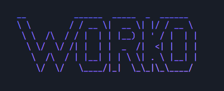

<div align="center">
  
</div>


<p align="left">
  
  
  
  
  
  
  
  
  
  
  
  
  
  
</p>

A modern, full-stack TypeScript monorepo — NestJS API, React frontend, BullMQ worker, centralized Prisma database, and a root-level CLI to control everything from one place.

---

## Table of Contents

- [Architecture](#architecture)
- [Tech Stack](#tech-stack)
- [Getting Started](#getting-started)
- [CLI Reference](#cli-reference)
- [API Endpoints](#api-endpoints)
- [Project Status](#project-status)

---

## Architecture

```
worko/
├── apps/
│   ├── backend_api/        # NestJS REST API            (name: "worko")
│   ├── frontend_ui/        # React 19 + Vite 8          (name: "frontend")
│   └── worker/             # BullMQ job processor       (name: "@worko/worker")
│
├── packages/
│   ├── database/           # Prisma 7 schema + client   (name: "@worko/database")
│   └── auth-sdk/           # Better Auth client SDK     (name: "@worko/auth-sdk")
│
├── tools/
│   └── cli/                # Root CLI (routes, health, db …)
│
├── infrastructure/
│   └── docker/
│       ├── docker-compose.yml
│       ├── Dockerfile.api
│       ├── Dockerfile.worker
│       ├── Dockerfile.frontend
│       └── nginx.conf
│
├── .github/workflows/ci.yml
├── package.json            # Centralized worko:* scripts
├── pnpm-workspace.yaml
└── turbo.json
```

### Data & Job Flow

```
Browser → Frontend UI
              ↓
         Backend API  ──► BullMQ Queue (Redis) ──► Worker ──► PostgreSQL
              ↓
         Better Auth (/api/v1/auth/*)
              ↓
         Prisma 7   ──► PostgreSQL (db.prisma.io / local)
```

---

## Tech Stack

| Layer | Technology |
|-------|-----------|
| Monorepo | pnpm Workspaces · Turborepo |
| Backend | NestJS 12 · TypeScript 6 · Express |
| Frontend | React 19 · Vite 8 · Tailwind CSS 4 · shadcn/ui |
| Database | PostgreSQL 17 · Prisma ORM 7 |
| Auth | Better Auth (email + GitHub/Google OAuth) |
| Queue | Redis 7 · BullMQ |
| Security | Arcjet (WAF + rate limiting) |
| Observability | NestJS Observe · WorkoLogger (chalk) |
| API Docs | Swagger / OpenAPI (dev only) |
| Testing | Vitest |
| Linting | Oxlint · Prettier |
| Infra | Docker · Nginx · GitHub Actions CI |

---

## Getting Started

### Prerequisites

- **Node.js** 22+
- **pnpm** 12.x
- **Docker Desktop** (optional — only for local PostgreSQL & Redis)

### 1. Clone & install

```bash
git clone https://github.com/Said-Bzioui/worko.git
cd worko
pnpm install
```

### 2. Configure environment variables

```bash
cp .env.example apps/backend_api/.env
# Edit apps/backend_api/.env — set DATABASE_URL, BETTER_AUTH_SECRET, ARCJET_KEY …
```

> [!CAUTION]
> Never commit `.env` files. All secrets must stay out of version control.

### 3. Start infrastructure (optional — if using local Docker)

```bash
pnpm worko:docker:up
```

### 4. Build shared packages

```bash
pnpm worko:db:build
pnpm --filter @worko/auth-sdk build
```

### 5. Run database migration

```bash
pnpm worko:db:migrate
```

### 6. Start development

```bash
# All apps in parallel (backend + frontend + worker)
pnpm worko:dev

# Or individually:
pnpm worko:backend:dev
pnpm worko:frontend:dev
pnpm worko:worker:dev
```

---

## CLI Reference

All commands run from the **monorepo root** (`D:\PROGRAMER\PROJECTS\worko`).

### 🚀 Development

| Command | Description |
|---------|-------------|
| `pnpm worko:dev` | Start all apps in parallel |
| `pnpm worko:backend:dev` | NestJS API in watch mode |
| `pnpm worko:frontend:dev` | Vite dev server |
| `pnpm worko:worker:dev` | BullMQ worker in watch mode |

### 🔨 Build

| Command | Description |
|---------|-------------|
| `pnpm worko:backend:build` | Build NestJS API |
| `pnpm worko:frontend:build` | Build React app |
| `pnpm worko:worker:build` | Build worker |
| `pnpm build` | Build all via Turborepo |

### ✅ Quality

| Command | Description |
|---------|-------------|
| `pnpm worko:backend:test` | Run Vitest tests |
| `pnpm worko:backend:lint` | Run Oxlint |
| `pnpm worko:frontend:lint` | Lint frontend |
| `pnpm typecheck` | TypeScript check (all) |

### 🗄️ Database

| Command | Description |
|---------|-------------|
| `pnpm worko:db:migrate` | `prisma migrate dev` (create + apply) |
| `pnpm worko:db:push` | `prisma db push` (no migration file) |
| `pnpm worko:db:deploy` | `prisma migrate deploy` (production) |
| `pnpm worko:db:seed` | Run seed script |
| `pnpm worko:db:studio` | Open Prisma Studio |
| `pnpm worko:db:generate` | Regenerate Prisma client |

### 🐳 Docker

| Command | Description |
|---------|-------------|
| `pnpm worko:docker:up` | Start PostgreSQL + Redis |
| `pnpm worko:docker:down` | Stop services |
| `pnpm worko:docker:logs` | Follow container logs |

### 🔍 CLI Tools (`tools/cli`)

| Command | Description |
|---------|-------------|
| `pnpm worko:routes` | List all API routes (table) |
| `pnpm worko:health` | Check services health |
| `pnpm worko routes` | Route explorer with banner |
| `pnpm worko db migrate [name]` | Migrate with ora spinner |
| `pnpm worko db studio` | Open Prisma Studio via CLI |

---

## API Endpoints

Base URL: `http://localhost:3000`

### Auth — Better Auth (`/api/v1/auth/*`)

| Method | Endpoint | Description |
|--------|----------|-------------|
| `POST` | `/api/v1/auth/sign-up/email` | Register with email & password |
| `POST` | `/api/v1/auth/sign-in/email` | Sign in |
| `POST` | `/api/v1/auth/sign-in/social` | OAuth (GitHub / Google) |
| `POST` | `/api/v1/auth/sign-out` | Sign out |
| `GET`  | `/api/v1/auth/session` | Current session |
| `GET`  | `/api/v1/auth/callback/:provider` | OAuth callback |

> [!NOTE]
> Requests must include an `Origin` header matching a trusted origin (e.g. `Origin: http://localhost:3000`) to pass Better Auth's CSRF protection.

### Users — NestJS (`/api/v1/users`)

| Method | Endpoint | Description |
|--------|----------|-------------|
| `POST` | `/api/v1/users` | Create user |
| `GET` | `/api/v1/users` | List all users |
| `GET` | `/api/v1/users/:id` | Get user by ID |
| `PATCH` | `/api/v1/users/:id` | Update user |
| `DELETE` | `/api/v1/users/:id` | Delete user |

### Other

| Method | Endpoint | Description |
|--------|----------|-------------|
| `GET` | `/api/v1/health` | Health check |
| `GET` | `/docs` | Swagger UI (dev only) |

---

## Project Status

| Component | Status |
|-----------|--------|
| Monorepo (pnpm + Turborepo) | ✅ Done |
| Backend API (`apps/backend_api`) | ✅ Done |
| Frontend UI (`apps/frontend_ui`) | ✅ Done |
| Auth SDK (`packages/auth-sdk`) | ✅ Done |
| Database Package (`packages/database`) | ✅ Done |
| Background Worker (`apps/worker`) | ✅ Done |
| Redis & BullMQ | ✅ Done |
| Better Auth (email + OAuth) | ✅ Done |
| Prisma Migration | ✅ Done |
| WorkoLogger (NestJS custom logger) | ✅ Done |
| Root CLI (`tools/cli`) | ✅ Done |
| Docker Infrastructure | ✅ Configured |
| GitHub Actions CI | ✅ Configured |
| Projects Module | 🔜 Planned |
| Tasks Module | 🔜 Planned |
| Notifications Module | 🔜 Planned |
| E2E Testing | 🔜 Planned |
| Production Deployment | 🔜 Planned |

---

## License

All rights reserved. WORKO is a proprietary project.
